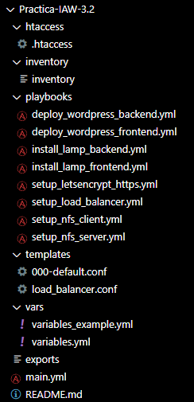
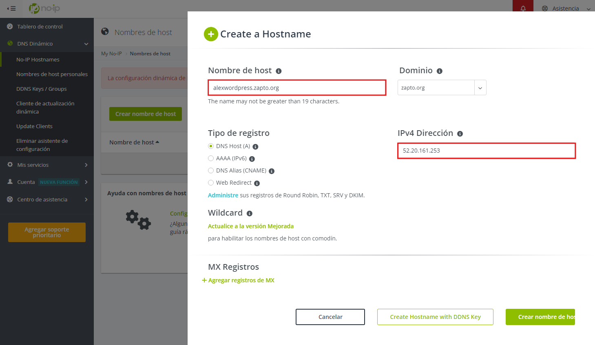
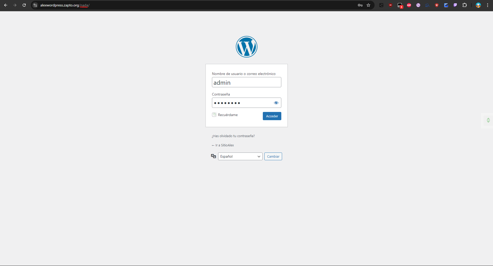
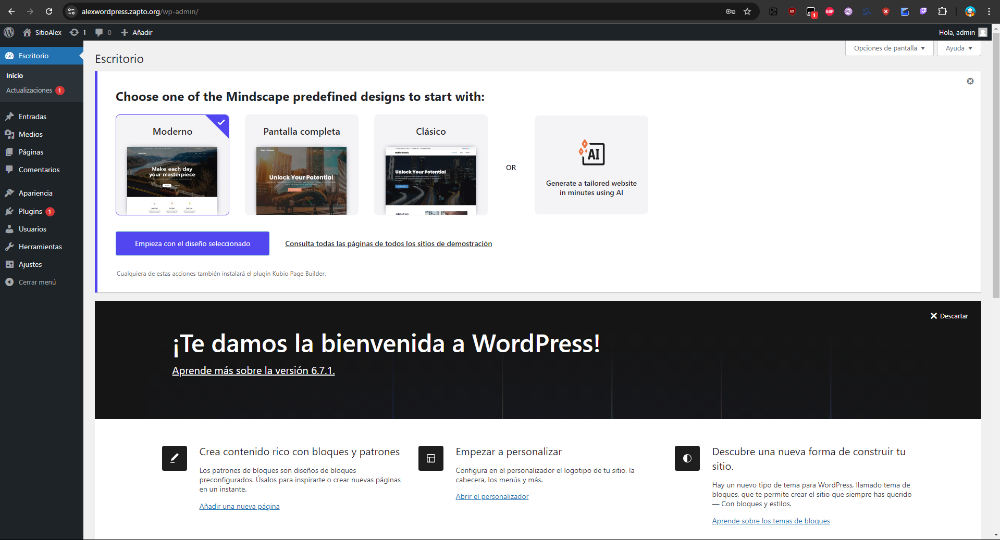

# Practica-IAW-3.2- Implantación de WordPress en tres niveles mediante Ansible

## Pasos previos a la instalación

**para la instalación vamos a tener que crear la siguiente estructura de directorios y archivos:**



**Una vez creados los archivos y directorios, procedemos a la instalación de las herramientas.**

## Implantación de WordPress en tres niveles mediante Ansible

## 1. Creamos un nombre de dominio para nuestro servidor con la web `no-ip`

### Paso 1. Crear el nombre del dominio 

Para crear el nombre de dominio en la página, tenemos que registrarnos y dirigirnos al sitio que muestra la captura y darle a **crear nombre de host**.



Una vez dado al recuadro de crear el nombre, nos sale un asistente para poner el nombre de host que queramos, el dominio que queremos que lleve, la dirección ip de la máquina o pc que queremos que tenga ese nombre de host y el tipo de registro que queremos que lleve, en nuestro caso es el **DNS Host A**

Hecho esto ya podemos automatizar la implantación de WordPress en tres niveles mediante Ansible

## 1.1 Infraestructura necesaria

La infraestructura necesaria está compuesta de cinco instancias EC2, un nodo de control para ejecutar los playbooks de ansible al resto de máquinas, dos Frontales donde en uno de los frontend se desplegará WordPress, un Backend donde tendremos la base de datos para WordPress y el usuario, un Balanceador de carga para que balancee entre los dos frontales y un servidor NFS para compartir el directorio a uno de los frontales donde se instalará WordPress.

* Nodo de control.
* Frontal con el WordPress desplegado.
* Frontal con el servidor web Apache desplegado.
* Servidor de Base de Datos MySQL (Backend).
* Balanceador de carga.
* Servidor de replicación de archivos (NFS).

## 1.2 Aspectos importantes a tener en cuenta

Para poder utilizar ansible debemos instalarlo con los siguientes comandos:

```bash
sudo apt update
sudo apt install ansible -y
```

Para que el nodo de control pueda ver las otras máquinas sin problemas, hay que crear una carpeta llamada `inventory` y dentro de ella un archivo llamado `inventory` con el siguiente contenido:

```yaml
[frontend]
<IP pública del primer Frontend>
<IP pública del segundo Frontend>

[frontend1] 
<IP pública del primer Frontend>

[backend]
<IP pública del Backend>

[balanceador]
<IP pública del Balanceador>

[nfs]
<IP pública del nfs>

[all:vars]
ansible_user=ubuntu
ansible_ssh_private_key_file=/ruta/a/la/clave/privada
ansible_ssh_common_args='-o StrictHostKeyChecking=accept-new'
```

> [!IMPORTANT]  
> `[frontend]:` Especifica el grupo de hosts que son parte del front-end de la infraestructura.  
> `[frontend1]:` Este grupo lo he hecho para que a la hora de hacer la instalación de WordPress, sólo lo instale en un frontal.   
> `[backend]:` Especifica el grupo de hosts que son parte del back-end de la infraestructura.   
> `[all:vars]:` Define variables globales que se aplican a todos los hosts.  
> `ansible_user=ubuntu:` El nombre de usuario que se usará para conectarse a los hosts.  
> `ansible_ssh_private_key_file=/ruta/a/la/clave/privada:` Ruta al archivo de clave privada SSH para autenticarse en los hosts.  
> `ansible_ssh_common_args='-o StrictHostKeyChecking=accept-new':` Argumentos adicionales de SSH, en este caso, para aceptar automáticamente nuevas claves de host sin preguntar.

También es importante darle los permisos necesarios a la clave `vockey.pem` para que pueda leer el archivo. Eso se puede hacer mediante chmod de la siguiente manera:

```bash
sudo chmod 400 vockey.pem
```

Para ejecutar los playbooks de ansible se hace de la siguiente forma:

```bash
sudo ansible-playbooks -i /ruta/al/inventario /ruta/al/archivo/yaml
```

## 2. Creación del archivo `install_lamp_frontend` para la instalación de apache en los frontales.

### Paso 1. Actualizamos los repositorios

```yaml
---
- name: Configuración de Apache y PHP en el fronted
  hosts: frontend
  become: yes

  tasks:

    - name: Actualizar los repositorios
      apt:
        update_cache: yes
```

### Paso 2. Instalamos el servidor web Apache

```yaml
    - name: Instalar el servidor web Apache
      apt:
        name: apache2
        state: present
```

### Paso 3. Habilitamos el módulo Rewrite

```yaml
    - name: Habilitar el módulo rewrite
      command: a2enmod rewrite
```

### Paso 4. Copiamos el archivo de configuración de Apache

```yaml
    - name: Copiar el archivo de configuración de Apache
      copy:
        src: ../templates/000-default.conf
        dest: /etc/apache2/sites-available/
        mode: 0755
```

### Paso 5. Instalamos PHP y algunos módulos necesarios para Apache y MySQL

```yaml
    - name: Instalar PHP y algunos módulos de PHP para Apache y MySQL
      apt:
        name:
          - php
          - libapache2-mod-php
          - php-mysql
        state: present
```

### Paso 6. Reiniciamos apache y modificamos el propietario y el grupo del directorio /var/www/html

```yaml
    - name: Reiniciar el servicio de Apache para aplicar los cambios
      service:
        name: apache2
        state: restarted

    - name: Modificar el propietario y el grupo del directorio
      file:
        path: /var/www/html
        owner: www-data
        group: www-data
        recurse: yes
```

## 2. Creación del archivo `install_lamp_backend` para la instalación de MySQL

### Paso 1. Incluimos el archivo de variables

```yaml
---
- name: Configuración de MySQL en el backend
  hosts: backend
  become: yes

  vars_files:
    - ../vars/variables.yml
```

### Paso 2. Actualizamos los repositorios

```yaml
  tasks:

    - name: Actualizar los repositorios
      apt:
        update_cache: yes
```

### Paso 3. Actualizamos los paquetes
```yaml
    - name: Actualizar los paquetes
      apt:
        upgrade: dist
        update_cache: yes
```

### Paso 4. Instalamos MySQL Server

```yaml
    - name: Instalar MySQL server
      apt:
        name: mysql-server
        state: present
```

### Paso 5. Instalamos el módulo de PyMySQL

```yaml
    - name: Instalamos el módulo de pymysql
      apt:
        name: python3-pymysql
        state: present
```


### Paso 6. Configuramos el archivo mysqld.cnf

```yaml
    - name: Configurar el archivo mysqld.cnf
      replace:
        path: /etc/mysql/mysql.conf.d/mysqld.cnf
        regexp: '127.0.0.1'
        replace: "{{ db.BACKEND_PRIVATE_IP }}"
```

> [!IMPORTANT]  
>Las variables que irán apareciendo durante los pasos están todas definidas en el archivo variables.yml y en variables_example.yml se pueden ver las variables que hay que tener definidas.

### Paso 7. Reiniciamos el servicio de MySQL

```yaml
    - name: Reiniciar el servicio de MySQL
      service:
        name: mysql
        state: restarted
```

## 3. Creación del archivo `setup_letsencrypt_https` para la implementación del certificado de la página web

### Paso 1. Incluimos el archivo de variables

```yaml
---
- name: Playbook para configurar HTTPS
  hosts: balanceador
  become: yes

  vars_files:
    - ../vars/variables.yml
```

### Paso 2. Desinstalamos instalaciones previas de Certbot

```yaml
  tasks:

    - name: Desinstalar instalaciones previas de Certbot
      apt:
        name: certbot
        state: absent
```

### Paso 3. Instalamos Certbot con snap

```yaml
    - name: Instalar Certbot con snap
      snap:
        name: certbot
        classic: yes
        state: present
```

### Paso 4. Solicitamos y configuramos el certificado SSL/TLS a Let's Encrypt con Certbot

```yaml
    - name: Solicitar y configurar certificado SSL/TLS a Let's Encrypt con certbot
      command:
        certbot --apache \
        -m {{ certbot.le_email }} \
        --agree-tos \
        --no-eff-email \
        --non-interactive \
        -d {{ certbot.le_domain }}
```

## 4. Creación del archivo `setup_load_balancer` para la implementación del balanceador de carga

### Paso 1. Incluimos el archivo de variables

```yaml
---
- name: Configuración de Nginx en el balanceador
  hosts: balanceador
  become: yes

  vars_files:
    - ../vars/variables.yml
```

### Paso 2. Actualizamos los repositorios

```yaml
  tasks:

    - name: Actualizar los repositorios
      apt:
        update_cache: yes
```

### Paso 3. Actualizamos los paquetes

```yaml
    - name: Actualizar los paquetes
      apt:
        upgrade: dist
        update_cache: yes
```

### Paso 4. Instalamos Nginx

```yaml
    - name: Instalar Nginx
      apt:
        name: nginx
        state: present
```

### Paso 5. Deshabilitamos el enlace simbólico default (si existe)

```yaml
    - name: Deshabilitar el enlace simbólico default (si existe)
      file:
        path: /etc/nginx/sites-enabled/default
        state: absent
```

### Paso 6. Copiamos el archivo de configuración de Nginx

```yaml
    - name: Copiar el archivo de configuración de Nginx
      copy:
        src: ../templates/load_balancer.conf
        dest: /etc/nginx/sites-available
        mode: '0644'
```

### Paso 7. Modificamos el archivo de cofiguración con las IPs correctas

```yaml
    - name: Modificar el archivo de configuración con las IPs correctas
      replace:
        path: /etc/nginx/sites-available/load_balancer.conf
        regexp: 'IP_FRONTEND_1'
        replace: "{{ balanceador.IP_FRONTEND_1 }}"
      notify: Reload Nginx

    - name: Modificar el archivo de configuración con las IPs y dominio correctos
      replace:
        path: /etc/nginx/sites-available/load_balancer.conf
        regexp: 'IP_FRONTEND_2'
        replace: "{{ balanceador.IP_FRONTEND_2 }}"
      notify: Reload Nginx
```

### Paso 8. Modificamos el archivo de configuración con el dominio correcto

```yaml
    - name: Modificar el archivo de configuración con el dominio correcto
      replace:
        path: /etc/nginx/sites-available/load_balancer.conf
        regexp: 'LE_DOMAIN'
        replace: "{{ certbot.le_domain }}"
      notify: Reload Nginx
```

### Paso 9. Activamos el archivo de configuración del balanceador de carga y reiniciamos Nginx

```yaml
    - name: Activar el archivo de configuración del balanceador de carga si no está activo
      file:
        src: /etc/nginx/sites-available/load_balancer.conf
        dest: /etc/nginx/sites-enabled/load_balancer.conf
        state: link
        force: no
      notify: Reload Nginx

  handlers:
    - name: Reload Nginx
      service:
        name: nginx
        state: reloaded
```

## 5. Creación del archivo `setup_nfs_server` para la implementación del servidor NFS

### Paso 1. Incluimos el archivo de variables

```yaml
---
- name: Configuración del servidor NFS
  hosts: nfs
  become: yes
  
  vars_files:
    - ../vars/variables.yml
```

### Paso 2. Actualizamos los repositorios

```yaml
  tasks:

    - name: Actualizar los repositorios
      apt:
        update_cache: yes
```

### Paso 3. Actualizamos los paquetes

```yaml
    - name: Actualizar los paquetes
      apt:
        upgrade: dist
        update_cache: yes
```

### Paso 4. Instalamos el servidor NFS

```yaml
    - name: Instalar el servidor NFS
      apt:
        name: nfs-kernel-server
        state: present
```

### Paso 5. Creamos el directorio /var/www/html

```yaml
    - name: Crear el directorio /var/www/html
      file:
        path: /var/www/html
        state: directory
        owner: nobody
        group: nogroup
        mode: '0755'
```

### Paso 6. Configuramos los directorios exportados en /etc/exports

```yaml
    - name: Configurar los directorios exportados en /etc/exports
      lineinfile:
        path: /etc/exports
        line: "/var/www/html {{ nfscliente.client_ip }}(rw,sync,no_subtree_check,no_root_squash)"
        create: yes
```

### Paso 7. Reiniciamos el servicio NFS

```yaml
    - name: Reiniciar el servicio NFS
      service:
        name: nfs-kernel-server
        state: restarted
```

## 6. Creación del archivo `setup_nfs_client` para la implementación del cliente NFS

### Paso 1. Incluimos el archivo de variables

```yaml
---
- name: Configuración del cliente NFS
  hosts: frontend1
  become: yes
  
  vars_files:
    - ../vars/variables.yml
```

### Paso 2. Actualizamos los repositorios

```yaml
  tasks:

    - name: Actualizar los repositorios
      apt:
        update_cache: yes
```

### Paso 3. Actualizamos los paquetes

```yaml
    - name: Actualizar los paquetes
      apt:
        upgrade: dist
        update_cache: yes
```

### Paso 4. Instalamos el cliente NFS

```yaml
    - name: Instalar el cliente NFS
      apt:
        name: nfs-common
        state: present
```

### Paso 5. Montamos el directorio NFS
 
```yaml
    - name: Montar el directorio NFS
      command: mount {{ nfsserver.server_ip }}:/var/www/html /var/www/html
```

### Paso 6. Actualizamos /etc/fstam para montar el directorio NFS al iniciar

```yaml
    - name: Actualizar /etc/fstab para montar el directorio NFS al iniciar
      lineinfile:
        path: /etc/fstab
        line: "{{ nfsserver.server_ip }}:/var/www/html /var/www/html nfs auto,nofail,noatime,nolock,intr,tcp,actimeo=1800 0 0"
        create: yes
```

### Paso 7. Reiniciamos el servicio NFS

```yaml
    - name: Reiniciar el servicio NFS
      service:
        name: nfs-kernel-server
        state: restarted
```

## 7. Creación del archivo `deploy_wordpress_frontend` para la implementación e instalación de WordPress en un frontal

### Paso 1. Incluimos el archivo de variables

```yaml
---
- name: Playbook para la instalacion de WordPress en un frontal
  hosts: frontend1
  become: yes

  vars_files:
    - ../vars/variables.yml
```

### Paso 2. Eliminamos el directorio de instalación

```yaml
  tasks:

    - name: Eliminar el directorio de instalación
      file:
        path: /usr/local/bin/wp/
        state: absent
```

### Paso 3. Configuramos permisos de WP-CLI

```yaml
    - name: Configurar permisos de wp-cli
      file:
        path: /usr/local/bin/
        owner: www-data
        group: www-data
        mode: 0755
```

### Paso 4. Descargamos la utilidad WP-CLI

```yaml
    - name: Descargar la utilidad WP-CLI
      get_url:
        url: https://raw.githubusercontent.com/wp-cli/builds/gh-pages/phar/wp-cli.phar
        dest: /usr/local/bin/wp
        mode: 0755
```

### Paso 5. Eliminamos instalaciones previas de WordPress
 
```yaml
    - name: Eliminar instalaciones previas de WordPress
      file:
        path: /var/www/html/*
        state: absent
```

### Paso 6. Descargamos el código fuente de WordPress
```yaml
    - name: Descargar el código fuente de WordPress
      command: 
        wp core download \
        --locale="{{ wordpress.locale }}" \
        --path=/var/www/html \
        --allow-root
```

### Paso 7. Eliminamos wp-config.php si existe

```yaml
    - name: Eliminar wp-config.php si existe
      file:
        path: /var/www/html/wp-config.php
        state: absent
```

### Paso 8. Creamos el archivo de configuración de WordPress

```yaml
    - name: Crear el archivo de configuración de WordPress
      command: 
        wp config create \
        --dbname="{{ db.name }}" \
        --dbuser="{{ db.user }}" \
        --dbpass="{{ db.password }}" \
        --dbhost={{ db.BACKEND_PRIVATE_IP }} \
        --path={{ wordpress.directory }} \
        --allow-root
```

### Paso 9. Instalamos WordPress

```yaml
    - name: Instalar WordPress
      command: 
        wp core install \
        --url="{{ certbot.le_domain }}" \
        --title="{{ wordpress.title }}" \
        --admin_user="{{ wordpress.admin_user }}" \
        --admin_password="{{ wordpress.admin_password }}" \
        --admin_email="{{ wordpress.admin_email }}" \
        --path="{{ wordpress.directory }}" \
        --allow-root
```

### Paso 10. Configuramos permisos de los directorios necesarios

```yaml
    - name: Configuramos permisos de /var/www/html
      file:
        path: /var/www/html
        owner: www-data
        group: www-data
        mode: '0755'
        recurse: yes

    - name: Configuramos permisos de /var/www/html/wp-content/upgrade
      file:
        path: /var/www/html/wp-content/upgrade
        owner: www-data
        group: www-data
        mode: '0755'
        recurse: yes

    - name: Configuramos permisos de /var/www/html/wp-content/plugins
      file:
        path: /var/www/html/wp-content/plugins
        owner: www-data
        group: www-data
        mode: '0755'
        recurse: yes
```

### Paso 11. Instalamos y activamos el tema Mindscape

```yaml
    - name: Instalar y activar el tema Mindscape
      command: 
        wp theme install mindscape --activate \
        --path={{ wordpress.directory }} \
        --allow-root
```

### Paso 12. Instalamos y activamos el plugin wps-hide-login

```yaml
    - name: Instalar y activar el plugin wps-hide-login
      command: 
        wp plugin install wps-hide-login --activate \
        --path={{ wordpress.directory }} \
        --allow-root
```

### Paso 13. Configuramos el plugin wps-hide-login

```yaml
    - name: Configurar el plugin wps-hide-login
      command: 
        wp option update whl_page {{ wordpress.hide_login_url }} \
        --path={{ wordpress.directory }} \
        --allow-root
```

### Paso 14. Configuramos los enlaces permanentes

```yaml
    - name: Configurar los enlaces permanentes
      command: 
        wp rewrite structure '/%postname%/' \
        --path={{ wordpress.directory }} \
        --allow-root
```

### Paso 15. Copiamos el archivo .htaccess al directorio de WordPress

```yaml
    - name: Copiar el archivo .htaccess al directorio de WordPress
      copy:
        src: ../htaccess/.htaccess
        dest: "{{ wordpress.directory }}/.htaccess"
        owner: www-data
        group: www-data
        mode: '0644'
```

### Paso 16. Nos aseguramos que $_SERVER['HTTPS'] esté en wp-config.php

```yaml
    - name: Asegurar que $_SERVER['HTTPS'] esté en wp-config.php
      lineinfile:
        path: /var/www/html/wp-config.php
        line: "$_SERVER['HTTPS'] = 'on';"
        state: present
        insertbefore: "^define\\( 'DB_NAME', 'wordpress' \\);"
```

### Paso 17. Reiniciamos el servidor web Apache

```yaml
    - name: Reiniciar el servidor web Apache
      service:
        name: apache2
        state: restarted
```

## Comprobación de que WordPress funciona



